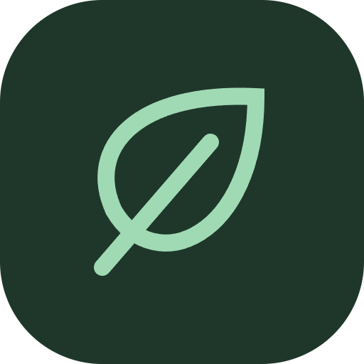
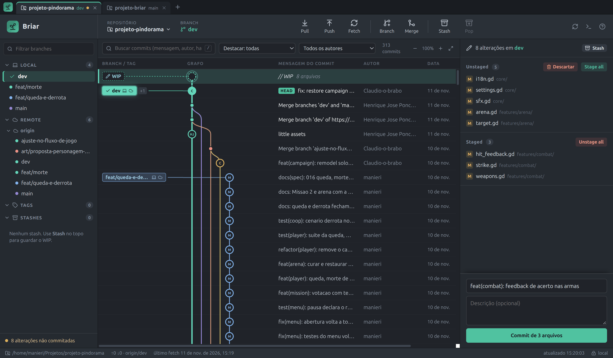
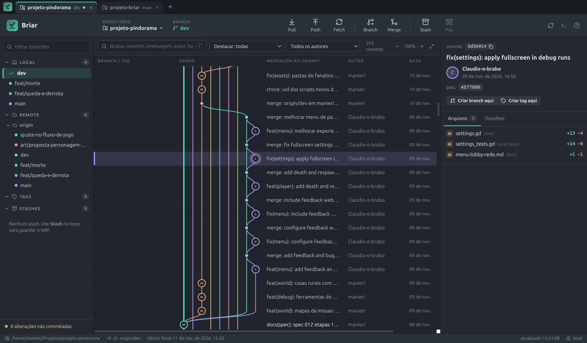
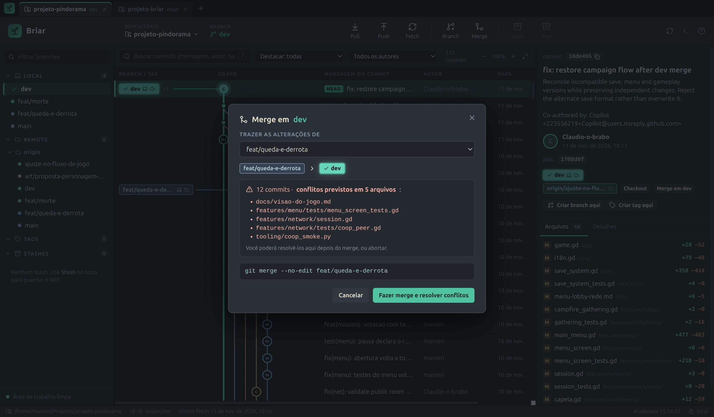
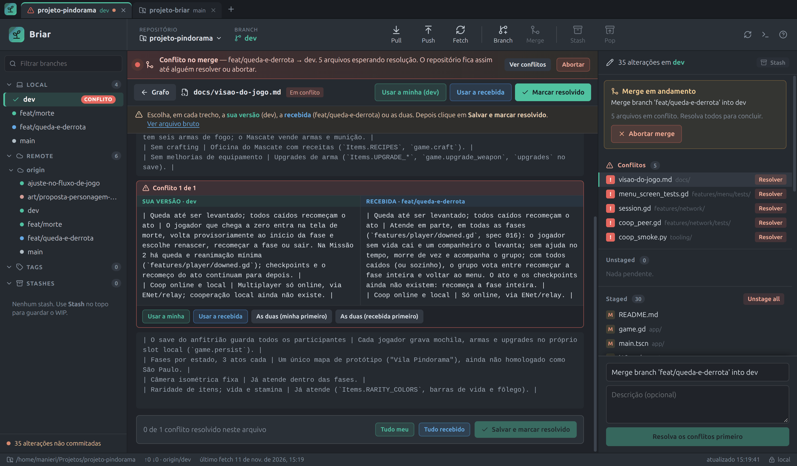
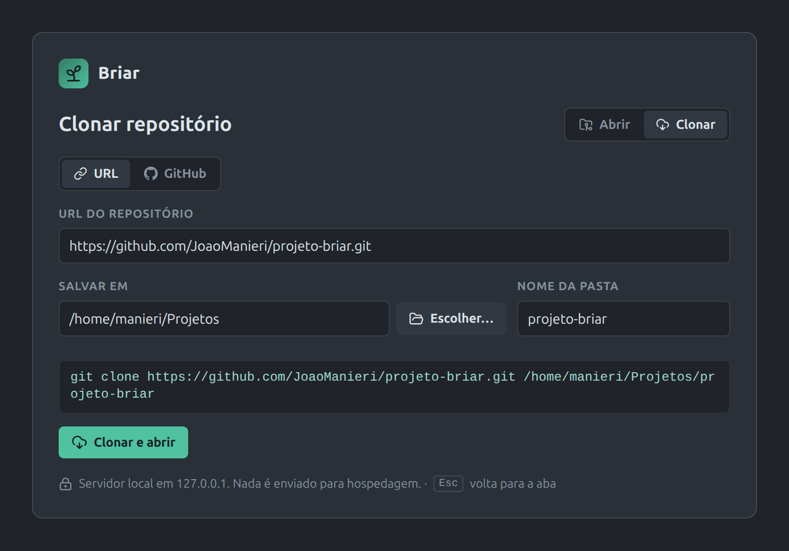

<div align="center">



# Briar

**The free, open-source Git GUI with a commit graph you'll actually enjoy using.**

Visual branch graph · drag-and-drop merges · side-by-side conflict resolution · tabs · stash · one-click clone from GitHub.<br>
Private repositories included. No account. No subscription. No telemetry.

[](https://github.com/JoaoManieri/projeto-briar/releases/latest)
[](LICENSE)


[**Download for Windows**](https://github.com/JoaoManieri/projeto-briar/releases/latest/download/Briar-Setup.exe) &nbsp;·&nbsp;
[**Download for Linux**](https://github.com/JoaoManieri/projeto-briar/releases/latest/download/Briar-x86_64.AppImage) &nbsp;·&nbsp;
[All downloads](#download) &nbsp;·&nbsp;
[🇧🇷 Português](README.pt-BR.md)

</div>



## Why Briar?

The nicest Git GUIs tend to put the essentials behind a sign-in screen and a monthly plan: private repositories, multiple tabs, a proper merge-conflict editor. **Briar doesn't.** Every feature works on every repository you have — public, private or your company's — and the whole app is MIT-licensed.

- **Free for real.** Private and organization repositories work out of the box. No trial, no "Pro" tier, no seat limits.
- **No Briar account.** Briar uses the Git and SSH credentials you already have, or signs in to GitHub through your browser. It never asks for your password.
- **Local-first.** Your code never leaves your machine. The interface talks to Git through a server bound to `127.0.0.1` only.
- **Real Git under the hood.** Every action runs the `git` you already have installed, and dialogs show you the exact command before it runs. No hidden magic, no proprietary repo format.
- **Safe by default.** No force push, no `reset --hard`, no rebase. Discarded changes go to the stash first and can be undone with one click.

## Features

### A commit graph you can read at a glance



- Every line of development gets its own colored lane; your current branch always sits in the first column, drawn thicker.
- Local and remote branches pointing at the same commit share one label (laptop and cloud icons), so the graph stays clean.
- Several branches on one commit collapse into **+N**; hover to see them all, click to check out, drag to merge.
- Search by message, author or hash (<kbd>/</kbd>), highlight one branch's history, filter by author, zoom, and move with <kbd>↑</kbd> <kbd>↓</kbd>.
- Click a commit to see the files it touched and the diff of each one.

### Drag. Drop. Merged.



- Drag a branch onto another — in the sidebar, on the graph or on the branch picker — to merge it.
- Before anything changes, Briar tells you how many commits are coming in and **exactly which files will conflict**.
- Target branch simply behind on the same line? Briar fast-forwards it — even when it isn't the branch you're on, without a checkout.
- Double-click any branch to check it out. Double-click a remote branch and Briar switches to your local copy and catches it up.

### Merge conflicts, side by side



- Every conflicting hunk is shown as **your version** next to the **incoming** one. One click keeps yours, takes theirs, or keeps both (in either order).
- A red banner keeps the conflict visible — even after a restart — until someone resolves it or aborts.
- Prefer your own editor? Fix the file there and mark it resolved. Then finish the merge — or abort and get your branch back exactly as it was.

### Clone from a URL — or straight from your GitHub account



- Paste any Git URL (HTTPS, SSH or a local path), choose a folder, and watch live progress. Cancel anytime.
- Or connect GitHub — **Sign in with GitHub** in your browser, your existing **GitHub CLI** login, or a personal access token — and pick from a searchable list of your personal, organization and collaborator repositories.
- The token is encrypted by your operating system's keychain and used for the GitHub API and for fetch, pull, push and clone with `https://github.com` remotes. It's passed to Git as an HTTP header, so it never ends up in the remote URL or in `.git/config`.
- The new clone opens in its own tab as soon as it's done.

### Everything else you'd expect

- **Tabs** for multiple repositories (<kbd>Ctrl</kbd>+<kbd>T</kbd>, <kbd>Ctrl</kbd>+<kbd>Tab</kbd>), each with its own state. An operation running in one tab never blocks the others.
- **Stage, unstage and commit** with a commit box that stays on screen no matter how many files you changed.
- **Stash** with a message, staged-only or including untracked files; pop, apply, create a branch from a stash, and undo a drop.
- **Discard with a safety net**: changes are stashed first and an undo button shows up right away.
- **Tags** that suggest the next version for you (`v1.0.4` → `v1.0.5`), annotated tags, push and delete — locally or on the remote.
- **Branches**: create from any commit, delete local and/or remote, with protection against losing commits that exist nowhere else.
- **Pull** (fast-forward or merge), **Push** (sets the upstream on the first push, never forces) and **Fetch**, plus a quiet background auto-fetch.
- **Right-click menus** on branches, tags and commits.
- **Operation log** with every Git command Briar ran during the session.
- **Automatic updates** on Windows and Linux.

> The screenshots show the real history of *Pindorama*, an indie game whose team uses Briar every day — busy branches, weekly merges, real conflicts.

## Download

| System | Download | Notes |
| --- | --- | --- |
| **Windows** | [**Briar-Setup.exe**](https://github.com/JoaoManieri/projeto-briar/releases/latest/download/Briar-Setup.exe) | Installer (recommended) |
| Windows | [Briar-Portable.exe](https://github.com/JoaoManieri/projeto-briar/releases/latest/download/Briar-Portable.exe) | Runs without installing |
| **Linux** | [**Briar-x86_64.AppImage**](https://github.com/JoaoManieri/projeto-briar/releases/latest/download/Briar-x86_64.AppImage) | Any distribution |
| Linux (Ubuntu/Debian) | [Briar-amd64.deb](https://github.com/JoaoManieri/projeto-briar/releases/latest/download/Briar-amd64.deb) | Shows up in your app menu |

Every version is on the [Releases page](https://github.com/JoaoManieri/projeto-briar/releases).

On first launch, Briar gets you ready in three steps:

1. **Git.** If it's missing, Briar installs it: through winget or the official Git for Windows installer on Windows, through your package manager on Linux.
2. **GitHub (optional).** Sign in through your browser, with your GitHub CLI login, or with a token.
3. **Your name and email** for commits, suggested from your GitHub account (including the private `noreply` address).

You can redo any of it later from **Configurar Git e GitHub** on the start screen. Push and pull use the same authentication as your terminal; with GitHub connected, `https://github.com` remotes use that account.

- **Windows:** run `Briar-Setup.exe`. The executables aren't code-signed yet, so SmartScreen may warn you: click **More info → Run anyway**. Signing will come through the SignPath Foundation; see the [code signing policy](CODE_SIGNING_POLICY.md).
- **Linux (AppImage):** `chmod +x Briar-x86_64.AppImage` and open it.
- **Linux (.deb):** `sudo apt install ./Briar-amd64.deb`.

Then click **Escolher pasta…** (choose folder) to open a repository you already have, or **Clonar** (clone) to download one. Briar checks for updates on launch and every 4 hours; on the installer, AppImage and .deb builds the update downloads in the background and asks you to restart.

## FAQ

**Is it really free?**
Yes. MIT license, every feature, as many private repositories as you want, no account.

**Does it work with GitLab, Bitbucket, Azure DevOps or my own server?**
Yes — anything `git` can talk to. GitHub additionally gets the repository list on the clone screen.

**Does Briar store my password?**
No. Push, pull and fetch go through your existing Git credential helper or SSH keys. If you connect GitHub, Briar keeps a GitHub token instead — never your password — encrypted by your OS (or in memory only, if no keychain is available), and uses it for `https://github.com` remotes.

**What language is the interface in?**
Brazilian Portuguese 🇧🇷, for now. The buttons are the Git words you already know — *Pull*, *Push*, *Fetch*, *Stage*, *Merge*, *Stash* — and every dialog shows the Git command it will run.

**macOS?**
There are no published macOS builds yet. Briar is plain Electron + Node, so running it from source should work, but it hasn't been tested there.

## Build from source

Requires **Node.js 22.13+** and **Git**.

```bash
git clone https://github.com/JoaoManieri/projeto-briar.git
cd projeto-briar
npm install
npm run app     # build the interface and open Briar in a window
npm run dev     # browser mode with hot reload at http://127.0.0.1:5173
npm test        # tests run against throwaway repositories
```

- `src/` — the interface (React + TypeScript).
- `server/` — Git operations, calling your system's `git`; cloning, the GitHub account and the first-run setup.
- `electron/` — the desktop window and auto-updates.
- `tests/` — tests for the Git layer.

Every push to `main` publishes a new release automatically. The release process is documented (in Portuguese) in [README.pt-BR.md](README.pt-BR.md#publicar-uma-versão), and Windows code signing in [docs/assinatura-windows.md](docs/assinatura-windows.md) and the [code signing policy](CODE_SIGNING_POLICY.md).

## License

[MIT](LICENSE) © João Manieri
