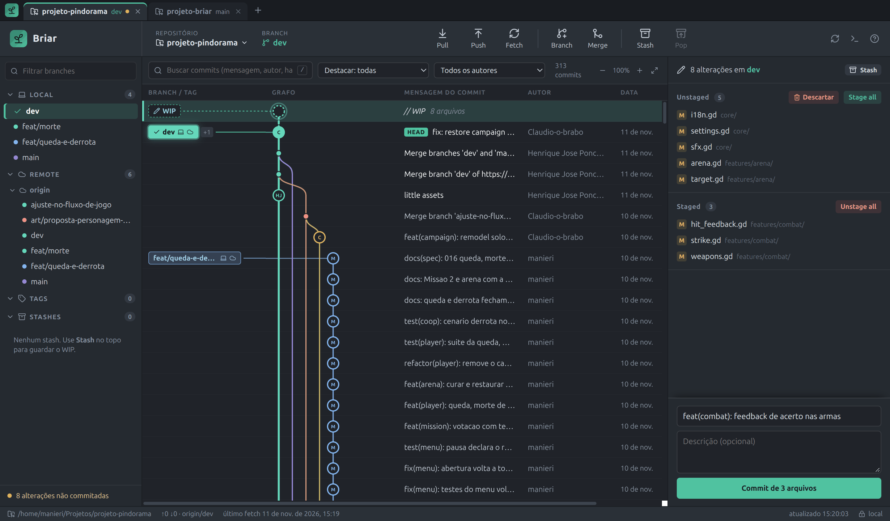
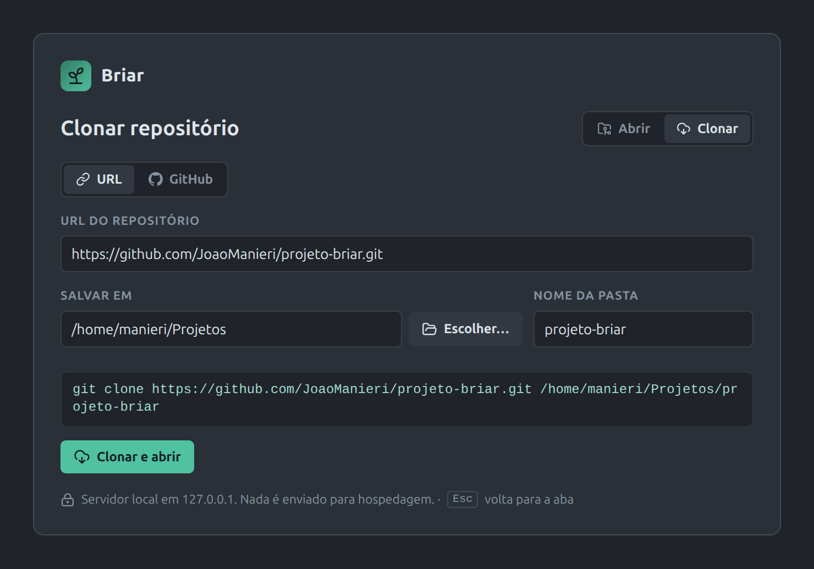
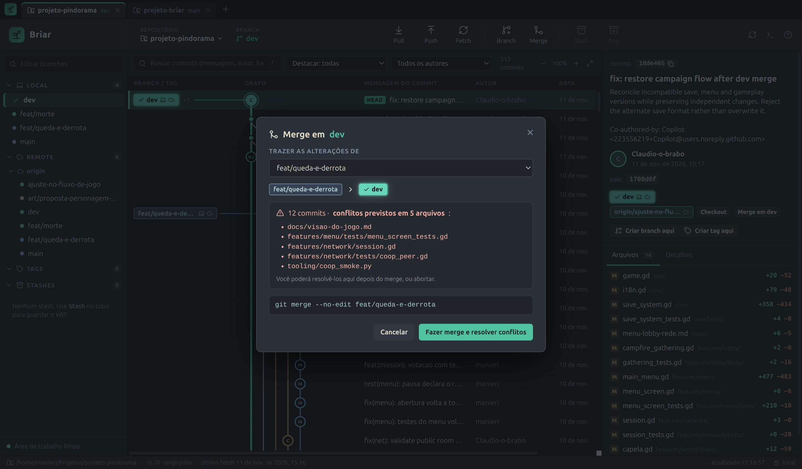
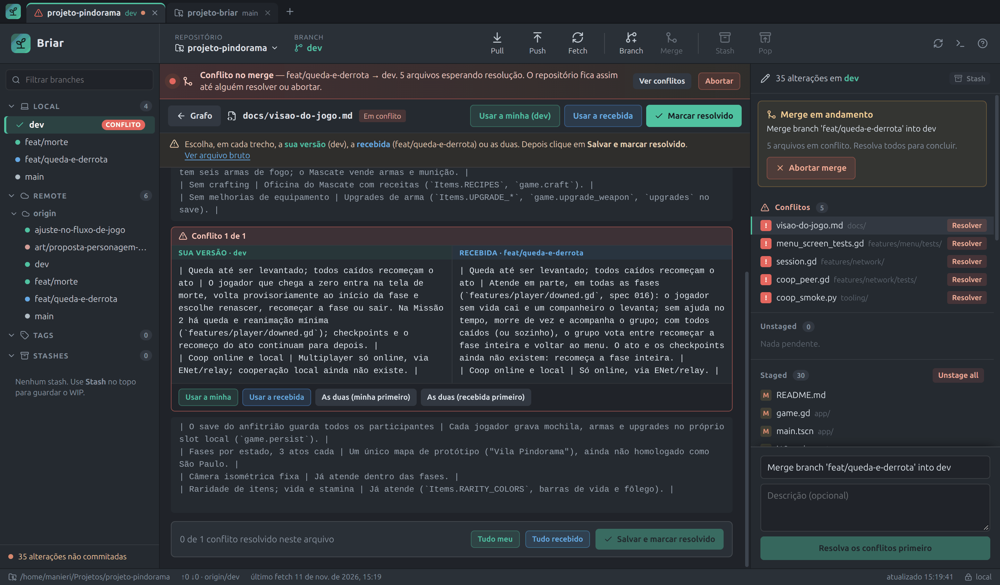

# Briar — cliente Git do time

🇺🇸 [English](README.md)

Cliente Git de desktop gratuito e de código aberto, feito para o time da Hipona Studios. Roda no seu computador, sobre o seu clone local, usando o Git instalado na máquina.



## Baixar

| Sistema | Download | Observação |
| --- | --- | --- |
| **Windows** | [**Briar-Setup.exe**](https://github.com/JoaoManieri/projeto-briar/releases/latest/download/Briar-Setup.exe) | Instalador (recomendado) |
| Windows | [Briar-Portable.exe](https://github.com/JoaoManieri/projeto-briar/releases/latest/download/Briar-Portable.exe) | Roda sem instalar |
| **Linux** | [**Briar-x86_64.AppImage**](https://github.com/JoaoManieri/projeto-briar/releases/latest/download/Briar-x86_64.AppImage) | Qualquer distribuição |
| Linux (Ubuntu/Debian) | [Briar-amd64.deb](https://github.com/JoaoManieri/projeto-briar/releases/latest/download/Briar-amd64.deb) | Aparece no menu de aplicativos |

Todas as versões: [página de Releases](https://github.com/JoaoManieri/projeto-briar/releases).

### Antes de instalar

Não precisa instalar nada antes. Na primeira vez que abre, o Briar mostra **Vamos deixar tudo pronto**:

1. **Git:** se faltar, o Briar instala. No Windows usa o winget ou o instalador oficial do Git for Windows; no Linux, o gerenciador de pacotes. O sistema pede a permissão de administrador. O `.deb` já instala o Git junto.
2. **Conta do GitHub (opcional):** **Entrar com o GitHub** abre o navegador com um código para autorizar o Briar. Também dá para usar o login do GitHub CLI ou um token.
3. **Nome e e-mail dos commits:** vêm sugeridos da conta do GitHub, inclusive o endereço privado `noreply`.

Para refazer depois: **Configurar Git e GitHub**, no rodapé da tela inicial.

### Instalar

- **Windows:** abra `Briar-Setup.exe` e siga o instalador. Os executáveis ainda não são assinados, então o SmartScreen pode avisar. Nesse caso clique em **Mais informações → Executar assim mesmo**. A assinatura vai vir pela SignPath Foundation ([política de assinatura](CODE_SIGNING_POLICY.md), [passo a passo](docs/assinatura-windows.md)).
- **Linux (AppImage):** `chmod +x Briar-x86_64.AppImage` e abra o arquivo.
- **Linux (.deb):** `sudo apt install ./Briar-amd64.deb`. Para desinstalar: `sudo apt remove briar`.

Ao abrir, clique em **Escolher pasta…** e selecione o seu clone, por exemplo `~/Projetos/projeto-pindorama`. O caminho fica salvo, e as abas abertas voltam na próxima vez.

Ainda não tem o projeto no computador? Use **Clonar** na mesma tela (veja abaixo).

### Atualizar

O Briar procura versão nova ao abrir e depois a cada 4 horas. Para procurar na hora, clique na versão (**Briar 0.x.y**) no canto inferior direito.

- **Instalador do Windows, AppImage e .deb:** a nova versão é baixada em segundo plano. Quando terminar, aparece **Reiniciar para atualizar** no topo. No `.deb` a instalação pede a senha de administrador.
- **Briar-Portable.exe:** aparece **Versão X disponível**, que abre a página de download. Baixe o novo executável no lugar do antigo.

A atualização automática começou na versão 0.4.0. Quem tem uma versão anterior precisa instalar a 0.4.0 manualmente uma vez.

## O que ele faz

- **Vários repositórios em abas.**
  - O **+** (ou <kbd>Ctrl</kbd>+<kbd>T</kbd>) mostra os repositórios salvos e permite abrir outro clone. Clicar no nome do repositório na barra de ferramentas faz o mesmo.
  - Cada aba tem o próprio estado. Um push numa aba não trava as outras.
  - A aba mostra a branch atual, um ponto quando há alterações não commitadas e um aviso quando há merge em andamento.
  - <kbd>Ctrl</kbd>+<kbd>Tab</kbd> troca de aba. O botão do meio do mouse fecha a aba.
- **Clonar repositório.** No **+** (ou <kbd>Ctrl</kbd>+<kbd>T</kbd>), escolha **Clonar**.
  - **URL:** cole o endereço (`https://…`, `git@github.com:…` ou um caminho local), escolha a pasta e o nome. O comando aparece antes, e o andamento (fase, %, velocidade) aparece durante, com **Cancelar**.
  - **GitHub:** conecte a conta e escolha na lista os seus repositórios, os das organizações e aqueles em que você colabora, com filtro. Dá para escolher SSH ou HTTPS; o padrão segue o que o GitHub CLI usa.
  - Para conectar: **Entrar com o GitHub** (abre o navegador com um código para autorizar), o login do **GitHub CLI** (`gh auth login`) ou um **token de acesso pessoal** com o escopo `repo` ([criar token](https://github.com/settings/tokens/new?description=Briar&scopes=repo,workflow,read:org,user:email)).
  - O token fica cifrado pelo cofre do sistema; sem cofre, vale só até fechar o Briar. Ele serve para a API do GitHub e para clone, fetch, pull e push em remotos `https://github.com`. Vai para o Git como cabeçalho HTTP e nunca para a URL do remoto nem para o `.git/config`. Remotos SSH e de outros servidores continuam com a autenticação do sistema.
  - Quando termina, o clone abre numa aba nova. Dá para voltar às outras abas enquanto ele roda: o **+** fica girando.

  
- **Descartar alterações (lixeira vermelha no WIP).**
  - Em cada arquivo, ou em **Descartar** no topo de Unstaged para todos de uma vez. Sempre pede confirmação.
  - O arquivo volta a ficar como no último commit: arquivos apagados voltam e arquivos novos somem.
  - Nada se perde de vez. As alterações vão para o stash do Git como "Briar: descartado…" e o aviso que aparece depois tem **Desfazer**. Mais tarde dá para recuperar com `git stash list` e `git stash apply`.
- **Stash do WIP.**
  - **Stash** no topo, ou no painel do WIP, guarda as alterações e limpa a área de trabalho. Dá para guardar só o que está em Staged e escolher se os arquivos novos entram.
  - Os stashes ficam na seção **STASHES** da lateral. Clicar num deles abre as opções e mostra os arquivos e o diff: **Pop** (aplica e remove), **Aplicar** (mantém guardado), **Branch** (cria uma branch onde o stash foi feito e o aplica ali) e **Apagar**, que tem **Desfazer** logo depois.
  - **Pop** no topo traz de volta o stash mais recente.
  - Se aplicar der conflito, os arquivos vão para "Conflitos" no WIP e o stash continua guardado.
- **Checkout com duplo clique.** Numa branch remota cuja local já existe (ex.: `origin/main` com `main`), o Briar troca para a local e a atualiza até o remoto quando possível. Se elas divergiram, ele avisa para fazer merge.
- **Arrastar para fazer merge.** Arraste uma branch sobre outra: na lateral, num rótulo do grafo ou no seletor de branch do topo.

  

  - Antes do merge aparece quantos commits entram e quais arquivos vão dar conflito.
  - Se o destino não é a branch atual, o Briar faz o checkout dele antes.
  - Se o destino é remoto, o merge vai para a branch local equivalente. Depois é só dar **Push**.
  - **Fast-forward:** se o destino só está atrás, na mesma linha, o Briar apenas avança a branch. Quando não é a branch atual, isso acontece sem checkout, e você continua onde está. O WIP não precisa estar limpo nesse caso.
  - Uma branch local atrás do remoto mostra ↓N na lateral. O botão ⏩ (ou **Fast-forward até origin/…** no botão direito) a atualiza sem trocar de branch.
- **Conflitos visíveis até alguém resolver.**
  - Uma faixa vermelha fica no topo e a branch aparece como **CONFLITO**. Isso continua mesmo depois de fechar e abrir o app, porque é o estado do próprio Git.
  - Cada arquivo abre num editor por trecho, com *sua versão* e *recebida* lado a lado e os botões *Usar a minha*, *Usar a recebida* ou *As duas*.
  - Depois, **Concluir merge** ou **Abortar**.

  
- **Botão direito em branches, tags e commits** (na lateral, no grafo e na lista "+N").
  - **Branch:** checkout, merge na atual, criar tag ali, apagar a local, apagar no remoto ou as duas.
    - A branch atual não pode ser apagada.
    - Se os commits dela não estão em nenhuma outra branch, o Briar recusa até você marcar "Apagar mesmo assim".
  - **Criar tag:** o nome já vem com o próximo número da última tag criada (`v1.0.4` → `v1.0.5`).
    - Não deixa repetir uma tag que já existe.
    - Com mensagem, vira tag anotada.
    - A caixa "Enviar a tag (push)" vem marcada.
  - **Tag:** push para o remoto, localizar no grafo, apagar local, apagar no remoto ou nos dois.
  - **Commit:** criar tag ou branch ali, copiar o hash.
- **Grafo** colorido, uma faixa por linha de desenvolvimento, com a branch atual sempre na primeira coluna.
  - Quando um commit tem várias branches, aparece **+N**. Ao passar o mouse abre a lista delas: clique numa para fazer checkout, ou arraste para fazer merge.
- **// WIP:** a linha no topo mostra os arquivos ainda não commitados. No painel direito ficam Stage/Unstage, diff e commit. Só a lista de arquivos rola: o resumo, a descrição e o botão de commit ficam sempre visíveis.
- **Pull** (fast-forward ou com merge), **Push** (cria o upstream na primeira vez, nunca faz force push), **Fetch** e **Branch**.
- Histórico das operações Git da sessão (ícone de terminal).

Não há rebase, reset hard nem force push. A troca de branch é bloqueada quando há alterações em arquivos rastreados (arquivos novos não atrapalham). Push, pull e fetch usam a configuração de Git/SSH já existente: o Briar nunca pede senha. O token do GitHub é opcional e só serve para listar e clonar repositórios.

Cada pessoa usa o Briar no próprio computador, com o próprio clone. O time continua se comunicando pelo remoto Git (push/pull).

## Desenvolver

Requer **Node.js 22.13+** e **Git**.

```bash
npm install
npm run app        # compila a interface e abre o Briar numa janela
npm run dev        # modo navegador com recarga automática: http://127.0.0.1:5173
npm test           # testes com repositórios temporários (não tocam no Pindorama)
```

No modo navegador dá para indicar o clone ao iniciar: `npm run dev -- --repo ~/Projetos/projeto-pindorama`.

Estrutura:

- `src/`: interface (React).
- `server/`: operações Git, chamando o `git` do sistema (`git.mjs`), clone (`clone.mjs`), conta do GitHub e login pelo navegador (`github.mjs`) e primeiro uso: instalar o Git, nome e e-mail (`setup.mjs`).
- `electron/`: janela do aplicativo.
- `tests/`: testes da camada Git e do primeiro uso.

O login pelo navegador precisa do Client ID do OAuth App do Briar, em `OAUTH_CLIENT_ID` (`server/github.mjs`). Para testar com outro app: `BRIAR_GITHUB_CLIENT_ID=… npm run app`.

## Publicar uma versão

Os links de download e a atualização automática usam sempre a Release mais recente do repositório `JoaoManieri/projeto-briar`.

**É automático: todo push na `main` publica uma versão nova.** O workflow **Instaladores** (`.github/workflows/build.yml`) faz o seguinte:

1. Calcula a versão com `scripts/next-version.mjs`. Normalmente é a última tag mais 1 no patch (`v0.6.2` → `0.6.3`).
2. Gera os instaladores de Windows e Linux com essa versão.
3. Publica a Release `vX.Y.Z` com os instaladores e os arquivos da atualização automática. A tag é criada nesse momento.

- **Subir minor ou major:** mude a versão no `package.json` (ex.: `0.7.0`) e faça o push. Se ela for maior que a última tag, vale ela. Depois disso o patch volta a subir sozinho.
- **Push sem Release:** ponha `[skip ci]` na mensagem do commit. Pushes que só mexem em arquivos `.md`, `LICENSE` ou `.gitignore` também não geram Release.
- **Não crie tags `v*` à mão.** O próprio workflow cria.
- Se o build falhar, a Release fica como rascunho e nada chega aos usuários. O próximo push tenta de novo com o mesmo número.
- **Assinatura do Windows:** quando a SignPath estiver configurada, o workflow assina o `Briar.exe`, o instalador e o portátil e espera aprovação no site da SignPath. Veja [docs/assinatura-windows.md](docs/assinatura-windows.md).

Para gerar e publicar à mão (só se o GitHub Actions estiver fora do ar):

1. Suba a versão em `package.json` (ex.: `0.4.1`).
2. Gere os instaladores. Eles saem em `release/`, sem a versão no nome, para os links continuarem valendo.
   - **No Windows:** `npm ci` e depois `npm run dist:win`. Gera `Briar-Setup.exe`, `Briar-Portable.exe`, `Briar-Setup.exe.blockmap` e `latest.yml`.
   - **No Linux:** `npm ci` e depois `npm run dist:linux`. Gera `Briar-x86_64.AppImage`, `Briar-amd64.deb` e `latest-linux.yml`.
   - Os arquivos `.yml` e `.blockmap` são o que a atualização automática lê. Envie-os junto com os instaladores.
3. Crie a Release e envie os arquivos. Com o GitHub CLI:

   ```bash
   gh release create v0.4.1 --title "Briar 0.4.1" --notes "O que mudou…"
   gh release upload v0.4.1 release/Briar-Setup.exe release/Briar-Portable.exe release/Briar-Setup.exe.blockmap release/latest.yml   # do Windows
   gh release upload v0.4.1 release/Briar-x86_64.AppImage release/Briar-amd64.deb release/latest-linux.yml                          # do Linux
   ```

   Também dá para arrastar os arquivos na página da Release, no site do GitHub.

O ícone sai de `public/favicon.svg`. Para regenerar: `npx electron scripts/make-icon.mjs`.

## Limites

- **Histórico carregado:**
  - O grafo carrega até 300 commits recentes de todas as referências e até 300 ancestrais do HEAD. Pontas tracejadas indicam ancestrais fora desse recorte.
  - Commits de merge mostram os pais em vez de um diff.
- **Diffs:** a revisão é por arquivo inteiro e cada diff vai até 250 KB.
- **Atualização:**
  - O estado é relido a cada 15 s, ao voltar à janela e após cada operação.
  - Fetch só acontece quando você clica nele ou num pull.
